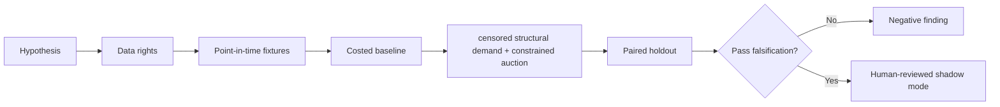

# WORKFLOW — Auction-Based Securities Lending Liquidity Discovery

1. Define decision: set fee and allocation for scarce lendable securities.
2. Ingest only authorized inputs: Timestamped locate quotes, revisions, rejects, fills, quantities and source-specific inventory.
3. Reject future information, unsupported eligible states and unpriced cost drivers.
4. Evaluate baseline highest-fee-first feasible allocation; then candidate censored structural demand + constrained auction.
5. Report net revenue, allocative efficiency, fill rate, churn and regret, sensitivities and risk censored demand, endogenous quote selection.
6. Archive source/version/hash details, failures and signoffs.
No step is a claim of actual execution.
