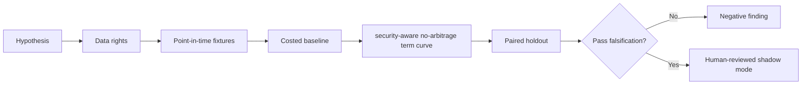

# WORKFLOW — Repo Term Structure Dislocation Engine

1. Define decision: choose term financing maturity and collateral route.
2. Ingest only authorized inputs: Repo rate/tenor quotes, SOFR, collateral CUSIP, haircut, balance-sheet dates.
3. Reject future information, unsupported eligible states and unpriced cost drivers.
4. Evaluate baseline overnight funding rollover; then candidate security-aware no-arbitrage term curve.
5. Report after-cost funding savings, basis convergence, risk and drawdown, sensitivities and risk indicative prices and bid/ask execution mismatch.
6. Archive source/version/hash details, failures and signoffs.
No step is a claim of actual execution.
