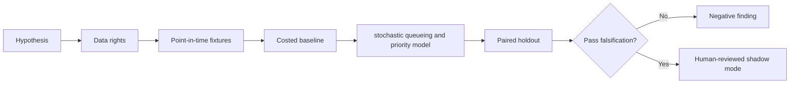

# WORKFLOW — Intraday Collateral Liquidity Forecasting via Queueing Theory

1. Define decision: size buffer and prioritize arriving collateral obligations.
2. Ingest only authorized inputs: Intraday margin calls, settlement timestamps, queue lengths, cash/collateral buffers, fails.
3. Reject future information, unsupported eligible states and unpriced cost drivers.
4. Evaluate baseline fixed intraday liquidity reserve; then candidate stochastic queueing and priority model.
5. Report liquidity buffer cost, p99 delay, shortfalls and failures, sensitivities and risk timestamp quality and hidden queue-priority rules.
6. Archive source/version/hash details, failures and signoffs.
No step is a claim of actual execution.
