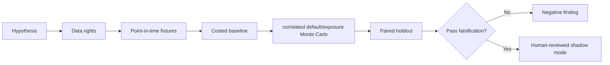

# WORKFLOW — Borrower Default Wrong-Way Risk Optimization

1. Define decision: price borrower limits, haircut and contingent indemnification.
2. Ingest only authorized inputs: Counterparty credit, collateral, contract closeout provisions, stress price and liquidity history.
3. Reject future information, unsupported eligible states and unpriced cost drivers.
4. Evaluate baseline independent PD times static haircut; then candidate correlated default/exposure Monte Carlo.
5. Report stress ES, loss calibration, limits used and risk-adjusted P&L, sensitivities and risk sparse default observations and unidentifiable tail parameters.
6. Archive source/version/hash details, failures and signoffs.
No step is a claim of actual execution.
