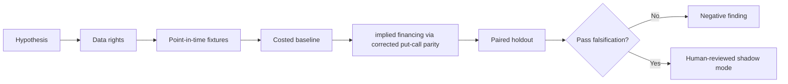

# WORKFLOW — Synthetic Borrow Supply via Options Parity

1. Define decision: choose physical versus synthetic financing exposure.
2. Ingest only authorized inputs: Options bid/ask, dividends, loan fees, stock price, funding, margin and assignment mechanics.
3. Reject future information, unsupported eligible states and unpriced cost drivers.
4. Evaluate baseline physical borrow only; then candidate implied financing via corrected put-call parity.
5. Report executable financing benefit, hedge error, margin and basis risk, sensitivities and risk American exercise and forecast-dividend mismatch.
6. Archive source/version/hash details, failures and signoffs.
No step is a claim of actual execution.
