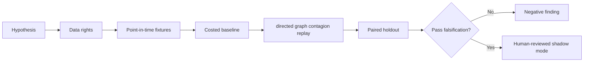

# WORKFLOW — Collateral Settlement Failure Propagation

1. Define decision: target the settlement legs whose failure causes the most downstream loss.
2. Ingest only authorized inputs: Dependency-linked settlement legs, legal routes, timestamps, collateral and failed instructions.
3. Reject future information, unsupported eligible states and unpriced cost drivers.
4. Evaluate baseline FIFO escalation by individual settlement; then candidate directed graph contagion replay.
5. Report cascade size, failed notional, recovery time and funding cost, sensitivities and risk incomplete external dependencies and cross-entity visibility.
6. Archive source/version/hash details, failures and signoffs.
No step is a claim of actual execution.
