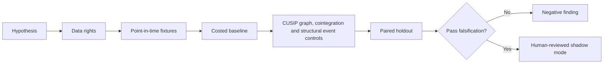

# WORKFLOW — Treasury Specials Relative-Value Network

1. Define decision: identify executable repo RV across related Treasury CUSIPs.
2. Ingest only authorized inputs: CUSIP-level repo and general-collateral rates, SOMA auctions, supply, futures basket, fails.
3. Reject future information, unsupported eligible states and unpriced cost drivers.
4. Evaluate baseline historical CUSIP z-score of specials; then candidate CUSIP graph, cointegration and structural event controls.
5. Report net spread convergence, realized returns, capital and fail risk, sensitivities and risk public SOMA cannot substitute for executable CUSIP quotes.
6. Archive source/version/hash details, failures and signoffs.
No step is a claim of actual execution.
