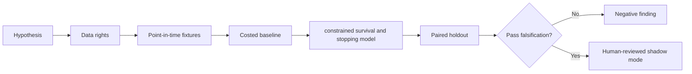

# WORKFLOW — Loan Recall Early-Exercise Boundary

1. Define decision: forecast compliant beneficial-owner recall exercise and source replacement.
2. Ingest only authorized inputs: Loan age, fee, recalls, corporate action calendar, owner restrictions, replacement cost.
3. Reject future information, unsupported eligible states and unpriced cost drivers.
4. Evaluate baseline constant owner-specific recall probability; then candidate constrained survival and stopping model.
5. Report recall warning, replacement cost, calibration and fail prevention, sensitivities and risk governance and fiduciary rights cannot be traded away.
6. Archive source/version/hash details, failures and signoffs.
No step is a claim of actual execution.
