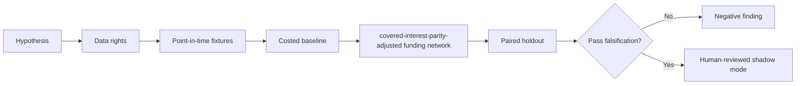

# WORKFLOW — Cross-Currency Repo Basis Optimization

1. Define decision: choose FX-hedged financing currency and legal collateral path.
2. Ingest only authorized inputs: FX swaps, currencies, tenor rates, haircuts, FX settlements, taxes, legal eligibility.
3. Reject future information, unsupported eligible states and unpriced cost drivers.
4. Evaluate baseline domestic collateral and repo only; then candidate covered-interest-parity-adjusted funding network.
5. Report hedged carry, capacity, FX basis risk and all-in spread, sensitivities and risk false arbitrage from stale asynchronous or inaccessible quotes.
6. Archive source/version/hash details, failures and signoffs.
No step is a claim of actual execution.
