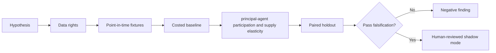

# WORKFLOW — Beneficial-Owner Revenue-Sharing Mechanism

1. Define decision: design fair participation-aware lending revenue splits.
2. Ingest only authorized inputs: Owner fee splits, available holdings, program restrictions, lending volume and recalls.
3. Reject future information, unsupported eligible states and unpriced cost drivers.
4. Evaluate baseline fixed schedule of revenue sharing; then candidate principal-agent participation and supply elasticity.
5. Report new supply, agent revenue, owner revenue, program retention, sensitivities and risk unobservable selection and fairness/fiduciary restrictions.
6. Archive source/version/hash details, failures and signoffs.
No step is a claim of actual execution.
