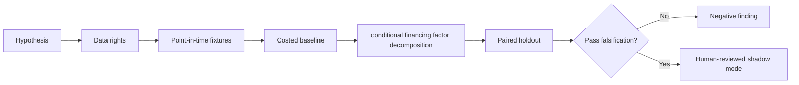

# WORKFLOW — Securities Lending Liquidity Provision Premium

1. Define decision: value dependable securities supply during high financing stress.
2. Ingest only authorized inputs: Lender inventory changes, special fees, recalls, utilization, systemic stress factors.
3. Reject future information, unsupported eligible states and unpriced cost drivers.
4. Evaluate baseline trailing revenue per lendable dollar; then candidate conditional financing factor decomposition.
5. Report stress carry, stability, adjusted yield and mandate value, sensitivities and risk composition and survivorship bias can masquerade as a premium.
6. Archive source/version/hash details, failures and signoffs.
No step is a claim of actual execution.
