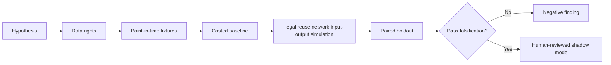

# WORKFLOW — Collateral Reuse Chain Stress Testing

1. Define decision: set buffers and resilience policies for eligible collateral transformation chains.
2. Ingest only authorized inputs: Source provenance, permissioned reuse contracts, collateral movements, haircut and margin events.
3. Reject future information, unsupported eligible states and unpriced cost drivers.
4. Evaluate baseline gross collateral stock and static stress; then candidate legal reuse network input-output simulation.
5. Report capacity contraction, margin calls, recovery time and chain failure, sensitivities and risk double counting and unsupported rehypothecation rights.
6. Archive source/version/hash details, failures and signoffs.
No step is a claim of actual execution.
