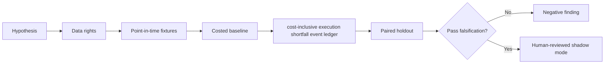

# WORKFLOW — Financing Execution Shortfall Model

1. Define decision: diagnose where quoted financing economics leak before completed settlement.
2. Ingest only authorized inputs: Timestamped RFQs, quotes, fill/rejects, booked fees, market moves and settlement.
3. Reject future information, unsupported eligible states and unpriced cost drivers.
4. Evaluate baseline executed spread minus indicative quote; then candidate cost-inclusive execution shortfall event ledger.
5. Report bps slippage, recovered P&L, latency and fill rate, sensitivities and risk quotes may be non-executable; client selection creates bias.
6. Archive source/version/hash details, failures and signoffs.
No step is a claim of actual execution.
