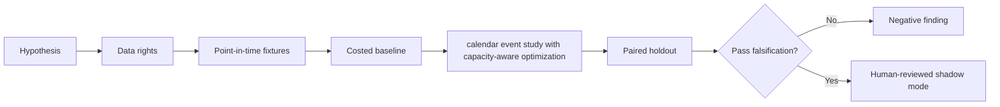

# WORKFLOW — Balance-Sheet Seasonality Arbitrage

1. Define decision: choose funding tenor and capacity reserves around reporting dates.
2. Ingest only authorized inputs: Repo spread term structure, settlement calendar, quarter-end dates, financing usage.
3. Reject future information, unsupported eligible states and unpriced cost drivers.
4. Evaluate baseline constant overnight-roll financing; then candidate calendar event study with capacity-aware optimization.
5. Report holdout funding cost, stress liquidity, rollover risk and drawdown, sensitivities and risk well-known quarter-end effects may already be fully priced.
6. Archive source/version/hash details, failures and signoffs.
No step is a claim of actual execution.
