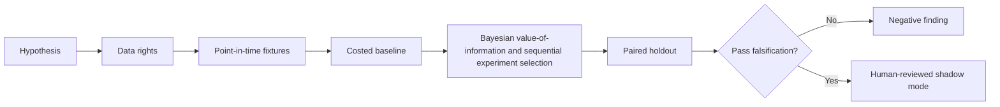

# WORKFLOW — Optimal Financing Research Experiment Design

1. Define decision: allocate scarce research effort to high information-value experiments.
2. Ingest only authorized inputs: Experiment budgets, model alternatives, synthetic case studies, past evidence quality and reproducibility logs.
3. Reject future information, unsupported eligible states and unpriced cost drivers.
4. Evaluate baseline equal effort per idea; then candidate Bayesian value-of-information and sequential experiment selection.
5. Report decision value per research hour, false discovery, stopping time and deployed value, sensitivities and risk retrospective outcomes are selectively recorded and success probabilities subjective.
6. Archive source/version/hash details, failures and signoffs.
No step is a claim of actual execution.
