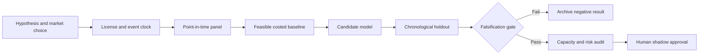

# WORKFLOW — Treasury Clearing Access-Path & Duplicate-Margin Optimizer

## Ordered workflow
**1. Ask a testable question:** Path-aware margin, clearing fees and funding costs change the optimal routing mix and reduce total economically consumed liquidity relative to selecting the lowest quoted repo rate.
**2. Set the decision:** Route eligible Treasury financing activity among legally permitted clearing access paths and participant entities while honoring CCP and customer-protection constraints.
**3. Acquire data:** Eligible trade templates; path availability; historical quote spreads; initial/variation margin stress; capital/CCLF allocation; modeled netting sets; direct/sponsored/agent fees.
**4. Freeze the temporal boundary:** trade routing decision at quote acceptance; historical public aggregates are lagged and cannot be used as intraday quotes
**5. Run baseline:** Minimize executable repo rate ignoring path-specific costs, after validating that every route is eligible.
**6. Evaluate candidate:** Mixed-integer convex routing with separate margin, settlement and liquidity shadow prices.
**7. Challenge method:** Stochastic two-stage CCP-margin and default-fund planning with cross-netting robustness., only if justified.
**8. Measure:** USD all-in funding cost, dollar liquidity encumbrance, margin stress p99, ineligible route count, rejection rate.
**9. Stress:** Clearing rule exemptions and netting eligibility vary; estimated margin offsets could be nonportable across entities.
**10. Fail/continue rule:** Reject if simulated net savings are below 2 bps of affected financing notional or vanish under independently validated margin rules.

For every failed gate record what was unavailable and why. All described execution stages are research plans, not completed model runs.
