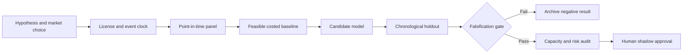

# WORKFLOW — Cash-Collateral Reinvestment Liquidity Run-Off Controller

## Ordered workflow
**1. Ask a testable question:** State-dependent loan run-off and reinvestment ladder simulation lowers liquidity shortfall probability versus static maturity and expected-return assumptions.
**2. Set the decision:** Allocate cash-collateral reinvestment across liquid buckets and pre-fund potential return obligations without sacrificing contractually required safety.
**3. Acquire data:** Loan termination flows; collateral principal; reinvestment settlement and maturity ladders; redemption windows; eligible funds; short-term yields; stress scenarios.
**4. Freeze the temporal boundary:** end-of-day reinvestment decision with availability of prior published cash flow and eligible settlement windows
**5. Run baseline:** Static liquidity buffer plus duration/weighted average life constraints.
**6. Evaluate candidate:** Conditional run-off survival model combined with stochastic cash-flow gap optimizer.
**7. Challenge method:** Distributionally robust multi-period policy with borrower return clustering and fire-sale haircuts., only if justified.
**8. Measure:** 99% liquidity shortfall, reinvestment net yield, liquidity carry, stressed liquidations, breach count.
**9. Stress:** Return flows may cluster under crises; survivorship of reinvestment balances causes understated withdrawals.
**10. Fail/continue rule:** Reject if stress shortfalls are not reduced by at least 10% without degrading contractual yield or creating maturity breaches.

For every failed gate record what was unavailable and why. All described execution stages are research plans, not completed model runs.
