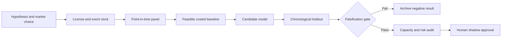

# WORKFLOW — Manufactured-Dividend and Corporate-Action Loan Economics

## Ordered workflow
**1. Ask a testable question:** Event-time aware loan optimization removes avoidable payment/operational leakage relative to fee-only renewal rules while remaining faithful to tax/legal restrictions.
**2. Set the decision:** Determine whether a permitted loan extension, pre-event return or alternative allocation is economically superior without compromising beneficial-owner legal rights.
**3. Acquire data:** Ex/record/pay dates; loan life; fee accrual; event elections; dividend amounts; owner tax flags and permitted return/recall rules.
**4. Freeze the temporal boundary:** event decisions before ex-date cutoff, using only announced corporate actions and approved tax interpretations then available
**5. Run baseline:** Renew if lending fee remains positive and return only upon explicit mandatory recall.
**6. Evaluate candidate:** Rule-checked event economics and constrained loan life-cycle integer optimizer.
**7. Challenge method:** Scenario tree for unresolved election announcements and corporate action adjustment ranges., only if justified.
**8. Measure:** net program income, missed payment events, operational exceptions, unauthorized action count.
**9. Stress:** Tax withholding, treaty benefits and manufactured-dividend treatment cannot be assumed from issuer-country information alone.
**10. Fail/continue rule:** Reject if post-cost incremental program income is nonpositive or event-aware policy increases mandatory-payment exceptions.

For every failed gate record what was unavailable and why. All described execution stages are research plans, not completed model runs.
