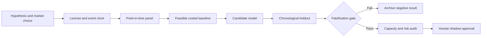

# WORKFLOW — Cleared Versus Tri-Party Repo Fragmentation Nowcast

## Ordered workflow
**1. Ask a testable question:** A public-data fragmentation state predicts next-session tail moves in funding conditions beyond aggregate SOFR and repo volume.
**2. Set the decision:** Adjust next-day funding risk overlays and desk liquidity buffers based on *publication-time* inter-venue segmentation rather than guessed live spreads.
**3. Acquire data:** OFR cleared and tri-party rate-volume series; collateral categories; SOFR; weekly dealer aggregate financing; release metadata.
**4. Freeze the temporal boundary:** risk update only after OFR release; cleared repo T+1 and tri-party T+2 availability; never use same-day unpublished values
**5. Run baseline:** SOFR level change and aggregate funding volume z-score.
**6. Evaluate candidate:** State-space latent fragmentation index with lag-aware missingness.
**7. Challenge method:** Hierarchical online change-point and causal regime attribution by venue and reporting channel., only if justified.
**8. Measure:** next-session stress AUPRC, calibrated Brier score, false alarm rate, funding stress drawdown.
**9. Stress:** Revised/missing suppressed OFR cells and cross-venue holiday timing can create lookahead and artificial divergences.
**10. Fail/continue rule:** Reject if lag-safe AUPRC does not exceed SOFR-only benchmark by 0.03 on an untouched crisis/quiet holdout.

For every failed gate record what was unavailable and why. All described execution stages are research plans, not completed model runs.
