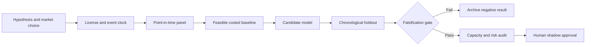

# WORKFLOW — Tri-Party Collateral Eligibility Clause-to-Constraint Compiler

## Ordered workflow
**1. Ask a testable question:** A dual-path deterministic parser plus LLM reviewer reduces incorrect collateral acceptances versus manually transcribed spreadsheets.
**2. Set the decision:** Compile approved eligibility schedules into testable constraints before collateral allocation, with human adjudication of ambiguous clauses.
**3. Acquire data:** Synthetic collateral schedules; asset master; rating/issuer; eligibility categories; haircut tables; human-labeled clause examples.
**4. Freeze the temporal boundary:** rules valid at collateral decision; amendments apply from legal effective date, not document creation date
**5. Run baseline:** Rule tables hand-transcribed and checked by two human operators.
**6. Evaluate candidate:** Schema-constrained text extraction with symbolic eligibility evaluation and abstention.
**7. Challenge method:** Contradiction-aware graph of rule amendments with formal test generation and reviewer feedback., only if justified.
**8. Measure:** false eligibility acceptance rate, false rejection rate, review labor, coverage, abstention, parse latency.
**9. Stress:** Natural-language ambiguity, contract precedence and jurisdiction-specific clauses make full automation unsafe.
**10. Fail/continue rule:** Reject if any critical false acceptance appears in stress fixtures or human review burden fails to improve.

For every failed gate record what was unavailable and why. All described execution stages are research plans, not completed model runs.
