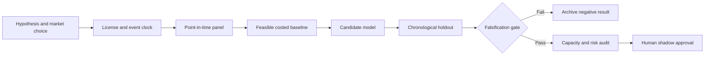

# WORKFLOW — Settlement-Fail Buy-In versus Wait Optimal Stopping

## Ordered workflow
**1. Ask a testable question:** A time-to-cure policy using fail penalties and executable cover costs lowers realized failure resolution expense versus fixed escalation cutoffs.
**2. Set the decision:** For an already-failed settlement instruction, decide when to cover, reroute or await delivery under documented close-out rules.
**3. Acquire data:** Public dealer failure aggregates for calibration; synthetic failure life histories; approved buy-in quotes, fails charges and legal remedies.
**4. Freeze the temporal boundary:** business-day cure decisions only after confirmed fail and remedy eligibility
**5. Run baseline:** Auto-escalate after fixed N-day failure age.
**6. Evaluate candidate:** Discrete-time survival model with exact dynamic-programming stopping rule.
**7. Challenge method:** Partial-observation optimal stopping with supply scarcity and stochastic cover price., only if justified.
**8. Measure:** resolved failure days, total cure cost, forced buy-in count, missed deadline, tail loss.
**9. Stress:** Fails charges and rights to enforce buy-ins differ by asset, market and contract; wrong assumptions invalidate decisions.
**10. Fail/continue rule:** Reject if holdout cost savings are below 5% or any mandated deadline is missed.

For every failed gate record what was unavailable and why. All described execution stages are research plans, not completed model runs.
