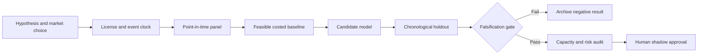

# WORKFLOW — Securities-Lending Fee Observability & Selection-Bias Corrector

## Ordered workflow
**1. Ask a testable question:** Explicit observability weighting and partial identification shrink apparent fee benchmark error versus sample-weighted means on contributor holdouts.
**2. Set the decision:** Publish uncertainty-aware fee benchmarks and abstain from quote-setting when selected sample coverage is inadequate.
**3. Acquire data:** Contributed executed fee samples; public security volume/short-interest proxies; locate response metadata; source coverage and revisions.
**4. Freeze the temporal boundary:** benchmark at next published cutoff; never use end-of-day contributions before receipt
**5. Run baseline:** Daily equally weighted or outstanding-value-weighted observed market fees.
**6. Evaluate candidate:** Doubly robust weighting with overlap and selection-sensitivity intervals.
**7. Challenge method:** Bayesian selection model with unverifiable missing-not-at-random stress bounds., only if justified.
**8. Measure:** cross-contributor benchmark error, interval coverage, abstention, quote drift, market breadth coverage.
**9. Stress:** Missing-not-at-random selection cannot be identified from executed loans alone; confidence intervals can be falsely narrow.
**10. Fail/continue rule:** Reject if cross-contributor MAE reduction <10% or intervals under-cover known withheld contributions.

For every failed gate record what was unavailable and why. All described execution stages are research plans, not completed model runs.
