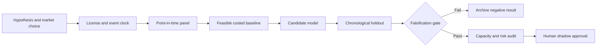

# WORKFLOW — Treasury Issuance-to-Dealer Intermediation Capacity Map

## Ordered workflow
**1. Ask a testable question:** Public auction-supply and weekly dealer-position innovations predict future Treasury liquidity stress more reliably than rate volatility alone.
**2. Set the decision:** Set research-level short-term Treasury liquidity stress overlays around security supply events, independent of day-of-quarter calendar effects.
**3. Acquire data:** Treasury auction issuance and settlement schedule; weekly primary dealer net positions/financing; OFR repo aggregates; public Treasury yield changes.
**4. Freeze the temporal boundary:** weekly close after primary dealer publication; never treat reported prior-week positions as contemporaneous
**5. Run baseline:** Treasury yield volatility and calendar week indicators.
**6. Evaluate candidate:** Event-study + state-space dealer supply absorption proxy.
**7. Challenge method:** Instrumented quasi-experiment using prescheduled auction supply shocks and cross-CUSIP constraints., only if justified.
**8. Measure:** stress forecast Brier, AUPRC, lead-time, false positives and hedge drawdown.
**9. Stress:** Aggregate dealer reports cannot identify securities or dealers and issuance is endogenous to financing conditions.
**10. Fail/continue rule:** Reject if no improvement over the rate-volatility-only benchmark on genuinely held-out issuance regimes.

For every failed gate record what was unavailable and why. All described execution stages are research plans, not completed model runs.
