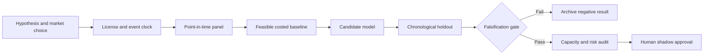

# WORKFLOW — Cross-Book Securities Finance Identity Reconciliation Graph

## Ordered workflow
**1. Ask a testable question:** A provenance-aware deterministic graph matcher reduces unresolved break hours and false exposure duplications compared with fuzzy string matching.
**2. Set the decision:** Resolve and quarantine inconsistent identities before financing position, collateral and exposure optimization.
**3. Acquire data:** Synthetic records containing lifecycle events, ISIN/CUSIP, product type, settlement date, amount, counterparty alias and amendment chain.
**4. Freeze the temporal boundary:** real-time/overnight reconciliation; no future correction can be applied retroactively to a prior risk snapshot
**5. Run baseline:** Exact ID join plus manually triaged fuzzy-name matches.
**6. Evaluate candidate:** Bipartite deterministic matching with hard identity constraints and provenance.
**7. Challenge method:** Human-review active-learning on uncertain clusters with error budget and privacy-preserving synthetic tests., only if justified.
**8. Measure:** false merge rate, unmatched %, time to resolve, duplicate exposure USD, manual review hours.
**9. Stress:** LLM or probabilistic model can silently merge legally distinct entities or settlement legs.
**10. Fail/continue rule:** Reject if critical false merges exceed zero in labeled holdouts or operations time does not decline.

For every failed gate record what was unavailable and why. All described execution stages are research plans, not completed model runs.
