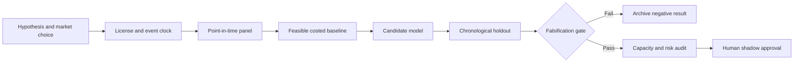

# WORKFLOW — Trade-Network Export-Shock Transmission to Equity Sectors

## Ordered workflow
**1. Ask a testable question:** Lag-aware product-network shocks identify medium-horizon cross-country sector earnings surprises beyond FX and industrial production.
**2. Set the decision:** Adjust public-market sector risk or hedges using time-valid trade-network concentration shocks, not a blunt GDP exposure factor.
**3. Acquire data:** UN Comtrade reported and partner-reported trade by HS code/month; sector country revenue mix; FX; sector returns and macro controls.
**4. Freeze the temporal boundary:** monthly after trade report publication and revision; NEVER trade at reference-month timestamp
**5. Run baseline:** Equal-weight country sector allocation with FX and local industrial production controls.
**6. Evaluate candidate:** Sparse directed trade graph factor with event-lag-aware regressions.
**7. Challenge method:** Causal graph neural propagation with hard release-vintage masking and sector earnings transmission., only if justified.
**8. Measure:** OOS sector information coefficient, dollar-neutral Sharpe, earnings revision hit rate, turnover and tail loss.
**9. Stress:** Revisions, late reporters, trade re-exports and mapping HS codes to listed firms can create survivorship and spurious exposure.
**10. Fail/continue rule:** Reject if positive net cross-country IC is not stable in each of two disjoint geographic holdouts or after publication lags.

For every failed gate record what was unavailable and why. All described execution stages are research plans, not completed model runs.
