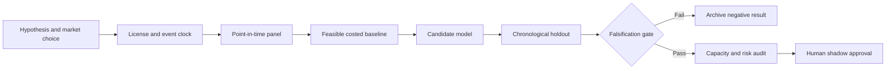

# WORKFLOW — EM External-Funding Fragility via Currency Mismatch and IIP

## Ordered workflow
**1. Ask a testable question:** Release-vintage normalized foreign-currency credit-to-external-assets mismatch predicts EM stress windows beyond carry and spot volatility.
**2. Set the decision:** Size EM FX downside budgets and sovereign duration exposures before external-funding shocks.
**3. Acquire data:** IMF IIP, BIS global liquidity quarterly FX credit, OECD macro where available, public reserve series and FX/sovereign returns.
**4. Freeze the temporal boundary:** quarterly risk changes after actual statistical release; never refresh historic positions with today's revised values
**5. Run baseline:** Traditional sovereign credit rating tier, FX carry and three-month realized volatility.
**6. Evaluate candidate:** Point-in-time standardized funding mismatch factor with recession/regime interactions.
**7. Challenge method:** Joint skewed macro-financial state-space with robust optimization and missing vintage uncertainty., only if justified.
**8. Measure:** EM FX crash recall, max drawdown, FX-adjusted stress Brier, portfolio VaR breaches.
**9. Stress:** Global liquidity metrics are quarterly; imputed weekly updates are model estimates, not observations.
**10. Fail/continue rule:** Reject if stress recall or drawdown control fails to beat carry-vol baseline in holdout crises.

For every failed gate record what was unavailable and why. All described execution stages are research plans, not completed model runs.
