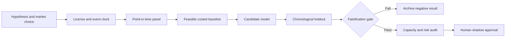

# WORKFLOW — US–Euro Sovereign Curve Shock Decomposition with Data Vintages

## Ordered workflow
**1. Ask a testable question:** Vintaged macro-announcement decomposition reduces out-of-sample cross-market duration hedge error versus rolling beta.
**2. Set the decision:** Allocate DV01-neutral rates hedge exposure between US and European curve tenors after releases, subject to actual market liquidity.
**3. Acquire data:** ECB published euro yield curve, US yields and ALFRED macro vintages, official release times, FX hedges, rates futures cost.
**4. Freeze the temporal boundary:** end-of-release or next-session decision after releases disseminate; avoid falsely assuming instant access to revised series
**5. Run baseline:** 60-day rolling DV01-neutral cross-market beta hedge.
**6. Evaluate candidate:** Vintaged announcement factor model plus shrinkage hedge weights.
**7. Challenge method:** Hierarchical structural yield-curve state-space with distinct real-rate and term-premium factor loading., only if justified.
**8. Measure:** OOS hedging variance reduction, implementation shortfall, tail DV01 loss, signal turnover.
**9. Stress:** Public releases cannot recreate market consensus surprises without a licensed historical consensus dataset or explicit no-consensus baseline.
**10. Fail/continue rule:** Reject if hedge variance does not improve at least 5% net of turnover on independent event holdout.

For every failed gate record what was unavailable and why. All described execution stages are research plans, not completed model runs.
