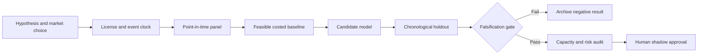

# WORKFLOW — AI Infrastructure Capex-to-Power-and-Export Supply Chain Factor

## Ordered workflow
**1. Ask a testable question:** Public capex-to-power-to-export bottleneck signals predict medium-horizon revisions across semiconductor equipment, utilities and data-center supply chains.
**2. Set the decision:** Construct capacity-confirmation exposures instead of mechanically buying companies mentioning AI investment.
**3. Acquire data:** SEC EDGAR filed capital expenditure and commitments, EIA power demand/generation, public utility service-area reports, UN Comtrade semiconductor/electrical equipment trade.
**4. Freeze the temporal boundary:** rebalance monthly after latest public filings, energy updates and international trade release
**5. Run baseline:** Equal-weight US tech/utility/semiconductor thematic basket with broad market hedge.
**6. Evaluate candidate:** Supply-chain bottleneck score anchored in publicly observed physical constraints.
**7. Challenge method:** Bayesian uncertainty propagation across disclosed commitments, supply chains and commodity/electricity capacity., only if justified.
**8. Measure:** sector-neutral residual return, realized earnings revision, stock/industry turnover and capacity sensitivity.
**9. Stress:** Disclosure boilerplate, future guidance and partial energy-grid footprint can generate strong hindsight mapping bias.
**10. Fail/continue rule:** Reject if holdout earnings-revision association and after-cost portfolio uplift vanish after mega-cap momentum controls.

For every failed gate record what was unavailable and why. All described execution stages are research plans, not completed model runs.
