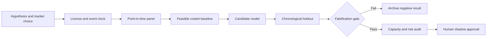

# WORKFLOW — CFTC Positioning Concentration and Commodity Curve Convexity

## Ordered workflow
**1. Ask a testable question:** CFTC public trader-category concentration interacts with futures curve slope/convexity to forecast downside tail asymmetry better than carry alone.
**2. Set the decision:** Scale futures trend/curve exposure after weekly public positioning releases with pre-set liquidation budgets.
**3. Acquire data:** CFTC Disaggregated COT futures positions, futures contracts prices/rolls, EIA physical inventories where applicable.
**4. Freeze the temporal boundary:** earliest action is CFTC publication/next executable session; no use of Tuesday positions on Tuesday
**5. Run baseline:** Futures curve carry/roll-yield and 12-month time-series momentum.
**6. Evaluate candidate:** Positioning-conditioned conditional expected shortfall regression.
**7. Challenge method:** Stochastic inventory-demand equilibrium with nonlinear dealer hedging and curve impact., only if justified.
**8. Measure:** tail loss reduction, annualized Sharpe after roll/slippage, opportunity-cost drag and hedge stability.
**9. Stress:** CFTC taxonomy changes, combined report double-counting and slow publication may annihilate predictive edge.
**10. Fail/continue rule:** Reject if tail-risk control does not beat carry/momentum or negative convexity effect changes sign in out-of-sample contracts.

For every failed gate record what was unavailable and why. All described execution stages are research plans, not completed model runs.
