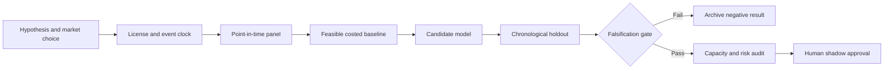

# WORKFLOW — Weather Forecast Revision as an Electricity-to-Gas Risk Hedge

## Ordered workflow
**1. Ask a testable question:** Timestamped forecast *revisions* explain next-session electricity net-load stress better than absolute forecast temperature or seasonal normals.
**2. Set the decision:** Size gas/power-linked hedges using only prior-issued weather forecasts and expected net-load revisions.
**3. Acquire data:** NWS issued and archived forecasts, EIA balancing authority hourly load and generation, power/gas futures settlements and basis.
**4. Freeze the temporal boundary:** forecast issuance is the earliest legal decision; never consume later realized weather or EIA actual load before release
**5. Run baseline:** Seasonal degree-day demand regression and absolute temperature forecasts.
**6. Evaluate candidate:** Net-load forecast-revision elasticity with non-linear stress threshold.
**7. Challenge method:** Probabilistic shortfall-and-constraint model with weather ensemble calibration., only if justified.
**8. Measure:** load p95 quantile loss, probabilistic calibration, hedge tracking error, net futures carry.
**9. Stress:** Archive of *historical forecasts as issued* may be inaccessible; today's historical observations are not contemporaneous forecasts.
**10. Fail/continue rule:** Reject if no improvements in forecast quantile loss or hedge after-cost variance over degrees-day baseline.

For every failed gate record what was unavailable and why. All described execution stages are research plans, not completed model runs.
