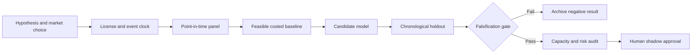

# WORKFLOW — Central-Bank Communication Semantic Surprise Across Languages

## Ordered workflow
**1. Ask a testable question:** Claim-grounded semantic stance revisions add stable information beyond rate decision and scheduled policy surprise alone across languages.
**2. Set the decision:** Quantify official policy-message *differences* between successive statements to adjust next-session FX/rates exposure.
**3. Acquire data:** Versioned official policy statements; actual publication timestamps; pre-event interest rate futures; FX and rates price bars; translated text audit.
**4. Freeze the temporal boundary:** after official statement becomes public; never permit news articles, transcripts or price reactions from after decision in input
**5. Run baseline:** Policy rate surprise (or no-surprise dummy without licensed expectation) and prior-day rate changes.
**6. Evaluate candidate:** Source-grounded claim-difference extractor with multilingual uncertainty and simple linear evaluation.
**7. Challenge method:** Constrained multilingual textual event state-space with calibration and abstention threshold., only if justified.
**8. Measure:** out-of-sample price direction log loss, FX hedge information ratio, translation agreement and unsupported claim rate.
**9. Stress:** Translation distortions, backfilled statement updates, and post-event news leakage are especially severe for multilingual event models.
**10. Fail/continue rule:** Reject if no incremental holdout log-loss improvement or semantic extractor makes unsupported claims on challenge set.

For every failed gate record what was unavailable and why. All described execution stages are research plans, not completed model runs.
