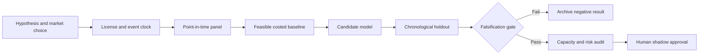

# WORKFLOW — Dynamic Currency-Hedge and Rebalancing Tax for Global Equity

## Ordered workflow
**1. Ask a testable question:** State-adaptive hedging reduces after-cost drawdown without sacrificing a pre-specified return floor relative to 0%, 50% and 100% static hedges.
**2. Set the decision:** Allocate country equity exposures and currency forward hedge ratios jointly under leverage, country, counterparty and capital-control constraints.
**3. Acquire data:** Country index total returns, currency spot/forward curves, FX liquidity, investability restrictions and funding rates.
**4. Freeze the temporal boundary:** rebalance at scheduled month-end using prior-close prices and then-available forward quotes
**5. Run baseline:** 50% static currency hedges plus equal-risk country weights and quarterly turnover.
**6. Evaluate candidate:** Robust covariance and transaction-cost-aware FX hedge optimizer.
**7. Challenge method:** Distributionally robust conditional hedge allocation with Markov stress regime and partial hedging., only if justified.
**8. Measure:** after-cost drawdown, lower-tail CVaR, rolling correlation, FX hedge turnover and volatility.
**9. Stress:** Country index histories have vendor survivorship and free-float methodological changes; FX pricing may be unavailable at allocated size.
**10. Fail/continue rule:** Reject if lower-tail risk not improved by at least 5% net of forward carry and turnover without violating return floor.

For every failed gate record what was unavailable and why. All described execution stages are research plans, not completed model runs.
