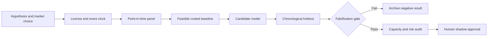

# WORKFLOW — Macro-Vintage Integrity Engine with Prediction Abstention

## Ordered workflow
**1. Ask a testable question:** A vintage-aware abstention gate reduces false active signals and revisional backtest overstatement versus always-on macro factor models.
**2. Set the decision:** Permit or abstain from a macro risk-signal update based on measured vintage quality, published delays and expected decision value.
**3. Acquire data:** ALFRED historical revisions, ECB yield releases, OECD SDMX data vintage calendars, US/global market proxies.
**4. Freeze the temporal boundary:** update only after first verified public release; revisions must enter as new events, not retroactively
**5. Run baseline:** Always-on macro momentum score built from latest-vintage series.
**6. Evaluate candidate:** As-of macro feature store with release-confidence model and abstention.
**7. Challenge method:** Bayesian missing-data multiple-vintage filtering and conformal selective prediction with capacity-aware portfolio overlay., only if justified.
**8. Measure:** revision-induced backtest bias, selective risk loss, coverage, false alarm rate, time-to-data-availability.
**9. Stress:** ALFRED historical series coverage, future revisions and OECD methodological breaks can be incomplete; abstention selection bias.
**10. Fail/continue rule:** Reject if abstention fails to reduce loss on corrected vintage history or simply abstains from all market decisions.

For every failed gate record what was unavailable and why. All described execution stages are research plans, not completed model runs.
