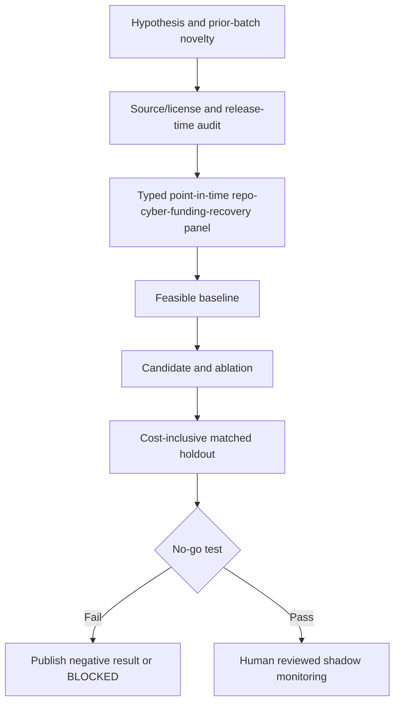

# WORKFLOW — Cyber-Outage Contingent Repo Funding Recovery Routes

## Decision-specific gates
1. Scope: Pre-approve alternate cash-lender/clearing routes and reserve a minimum contingency liquidity buffer for an exogenous operational outage.
2. Acquire only Timestamped anonymized funding route uptime, fallback approvals, cutoff times, public OFR repo volumes/rates, synthetic outage schedules. as legally allowed; OFR cleared rate/volume normally T+1 and tri-party T+2, so use public series as lagged calibration only; route outage telemetry must be timestamped pre-decision.
3. Check mathematical constraints: x are route and lender allocation decisions, b is reserved liquidity, p_s is the unit shortfall penalty in outage scenario s; legal availability, committed limits and collateral eligibility bound x.
4. Test `Fixed 10% contingency funding buffer with one permitted fallback` versus `Two-stage robust multi-commodity flow with cyber failure scenarios` on same opportunity set and costs.
5. Challenge result with: Public aggregates cannot recover the bank-level cash-lender network or prove an actual route is legally available.
6. Pre-committed stop: Held-out synthetic/approved outage replay fails to reduce mean + tail shortfall at fixed total contingency cost.
7. Present shortfall dollars, p95 duration, liquidity carry, fail probability, recovery cost and capital/execution capacity (Route/credit limits, settlement windows, cleared access and fallback switching charges; no publicly executable orders.).
8. Human review and explicit rollback. Negative outcomes remain research output.

**No workflow, connector or runtime was executed for this proposal.**
