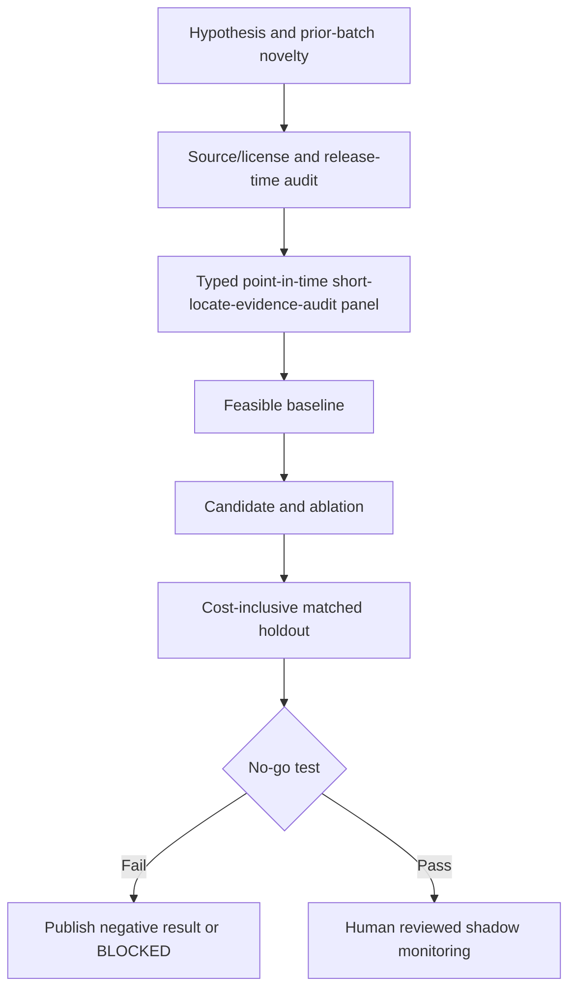

# WORKFLOW — Reg SHO Locate Evidence and Borrow-Capacity Audit Engine

## Decision-specific gates
1. Scope: Block or escalate a short-sale request if contemporaneous legally qualifying locate evidence or remaining documented quantity is insufficient.
2. Acquire only Synthetic short-sale order events, documented locate timestamps, source identity, shares remaining, exemptions and post-trade recalls; later private desk records only if approved. as legally allowed; Locate documentation and quantity must be timestamped before short sale; revised records cannot retroactively authorize prior orders.
3. Check mathematical constraints: FN is an incorrectly accepted exception, FP an incorrectly blocked valid locate, and Delay is processing latency; all compliance rules require human-verified effective policy and exemptions.
4. Test `End-of-day deterministic locate exception SQL rules` versus `Typed event-sourcing finite-state verification with causal explainability` on same opportunity set and costs.
5. Challenge result with: Reg SHO exemptions, broker responsibilities and settlement rules require qualified legal interpretation.
6. Pre-committed stop: Fails to flag intentionally missing/expired/overused locates on synthetic fixtures or blocks materially more valid trades than comparator.
7. Present prevented invalid requests, false blocks, recall error, audit completion time, p99 latency and capital/execution capacity (Low per-request CPU; overhead per manual escalation and strict audit storage/retention authorization.).
8. Human review and explicit rollback. Negative outcomes remain research output.

**No workflow, connector or runtime was executed for this proposal.**
