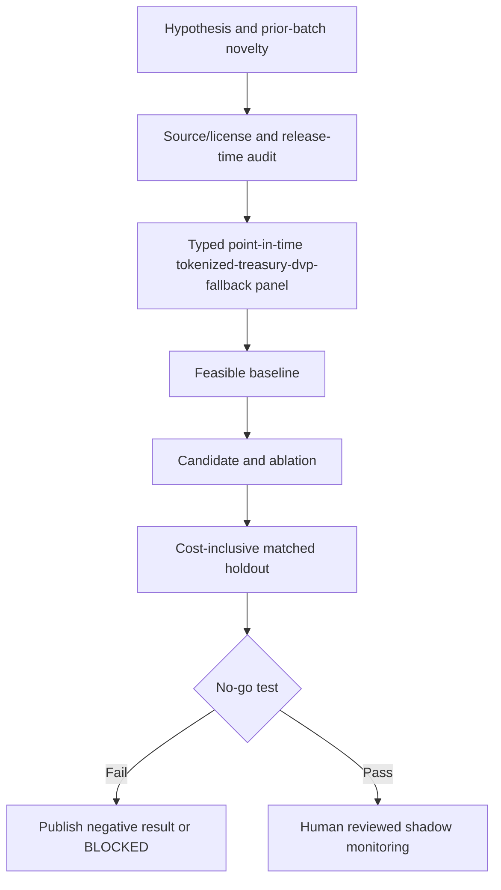

# WORKFLOW — Tokenized Treasury Collateral DvP Finality and Fallback Stress

## Decision-specific gates
1. Scope: Select permitted collateral settlement pathway with provable delivery-versus-payment, finality and fail-safe fallback.
2. Acquire only DTCC published service documentation, synthetic token mint-burn and conventional DvP events, validation proofs, cutoff windows and rehypothecation eligibility. as legally allowed; Use current production DTS service scope as of actual published date; planned 2027 integrations are NOT usable at a 2026 decision time.
3. Check mathematical constraints: r is a legally eligible path; require validated ownership, wallet permission, finality evidence, and a deterministic fallback if one leg fails.
4. Test `Conventional permitted book-entry DvP with settlement cutoff` versus `Timed Petri net state-machine model of mint/transfer/burn and escrow/finality rules` on same opportunity set and costs.
5. Challenge result with: Token entitlements must not be treated as interchangeable with every conventional collateral/clearing agreement.
6. Pre-committed stop: Cannot demonstrate legal/technical atomicity on synthetic fail-mid-transfer tests, or route fails to save liquidity net of controls.
7. Present liquidity-hours locked, failed atomicity scenarios, rollback time, eligible-settlement capacity and capital/execution capacity (Low experimental prototype capacity; real wallet, custody, settlement access and legal finality are gated by service rules.).
8. Human review and explicit rollback. Negative outcomes remain research output.

**No workflow, connector or runtime was executed for this proposal.**
