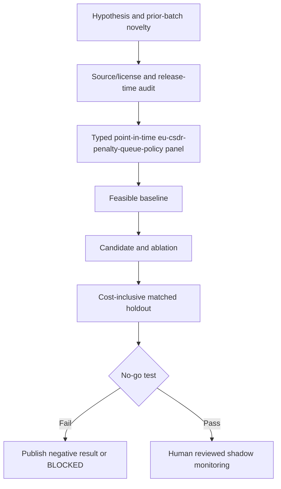

# WORKFLOW — European CSDR Penalty-Aware Settlement Queue Prioritization

## Decision-specific gates
1. Scope: Prioritize settlement instructions under explicit penalty eligibility and scarce processing resources.
2. Acquire only Public ESMA CSDR framework, synthetic ISIN liquidity/penalty groups, settlement instruction cutoff, fail reason and amendment history. as legally allowed; Penalty exclusions and rules must reflect versions legally in force before each instruction decision; ESMA technical advice is not automatically operative law.
3. Check mathematical constraints: pi is processing sequence, i instruction, penalty_i applies only under effective CSDR exclusions and jurisdictional rules; capacity_t is eligible CSD processing capacity.
4. Test `FIFO or largest-notional-first allowed settlement priority` versus `Constrained weighted-shortest-processing-time queue policy with eligibility rules` on same opportunity set and costs.
5. Challenge result with: Misclassification of non-attributable fail causes or legal exclusion yields incorrect optimized queues.
6. Pre-committed stop: No statistically measurable improvement in held-out synthetic and later approved settlement scenarios under equal capacity.
7. Present penalty liability, fail-days, priority-rule violations, operational throughput and capital/execution capacity (Settlement bandwidth/available inventory and mandatory processing priority; adverse-penalty reallocations cannot violate service commitments.).
8. Human review and explicit rollback. Negative outcomes remain research output.

**No workflow, connector or runtime was executed for this proposal.**
