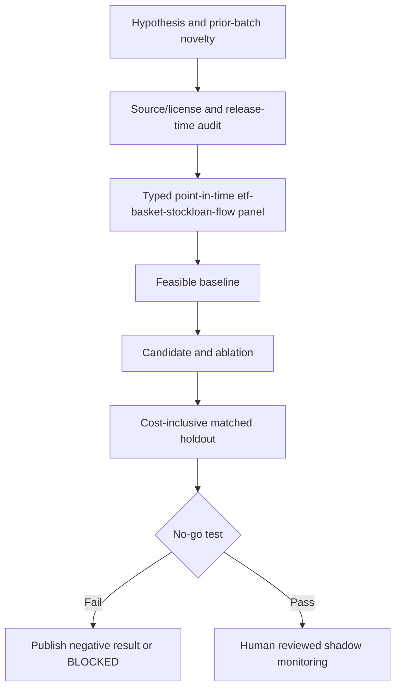

# WORKFLOW — ETF Creation/Redemption Basket Shock to Stock-Loan Supply

## Decision-specific gates
1. Scope: Reserve lendable constituent supply ahead of known or forecasted ETF in-kind redemption/creation windows.
2. Acquire only ETF disclosed holdings and creation units, public filings, official membership events, licensed AP basket/flows and loan availability for later study. as legally allowed; Only baskets available to a decision-maker before ETF order cutoff may be used; end-of-day holding reports are not morning baskets.
3. Check mathematical constraints: i is CUSIP, h forecast horizon, basket delta is an appropriately signed and actually available in-kind constituent-flow measure; no lookahead custom basket files.
4. Test `Change in ETF shares outstanding plus index-event dummy` versus `Hierarchical event study with issuer-basket aggregation and controls` on same opportunity set and costs.
5. Challenge result with: Most executable AP basket details and actual stock-loan supply are not public.
6. Pre-committed stop: No incremental held-out inventory signal after availability alignment and underlying stock flow controls.
7. Present inventory forecast MAE, short availability calibration, incremental net inventory carry, execution slippage and capital/execution capacity (Inventory is limited by mandate, lendability and recalls; transaction fees and timing dominate thin basket effects.).
8. Human review and explicit rollback. Negative outcomes remain research output.

**No workflow, connector or runtime was executed for this proposal.**
