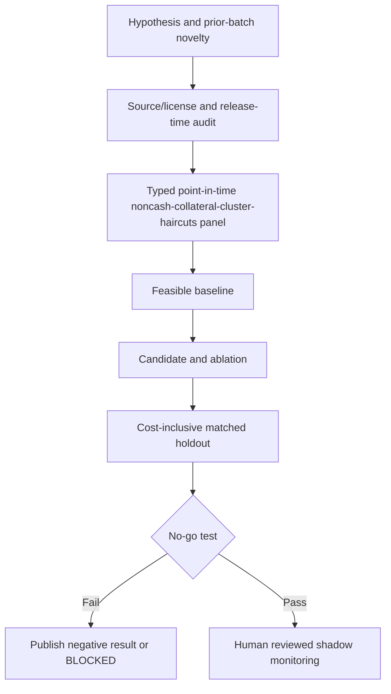

# WORKFLOW — Noncash Collateral Correlation-Cluster Haircut Controller

## Decision-specific gates
1. Scope: Recommend minimum defensive haircuts for a collateral basket based on joint concentration and liquidation correlation.
2. Acquire only Approved collateral constituents, synthetic issuer cross-holdings, stressed factor returns, liquidation bid/ask, haircut and legal threshold. as legally allowed; Apply only return histories, prices, group linkages and issuer memberships known at the decision timestamp.
3. Check mathematical constraints: h is haircut vector, alpha tolerated tail probability and cap issuer concentration; credit/legal eligibility are hard constraints.
4. Test `Uniform issuer/asset-class static haircut` versus `Scenario CVaR optimization with issuer cluster caps` on same opportunity set and costs.
5. Challenge result with: Asset covariance may break exactly when haircuts are needed and public free-float proxies omit liquidation controls.
6. Pre-committed stop: Risk benefit disappears when using stressed-correlation holdouts or violates legal haircut floors.
7. Present shortfall ES, collateral usage, haircut turnover, stress exceptions and capital/execution capacity (Financing spread effects, haircuts, asset transfer restrictions, concentration penalties and market impact.).
8. Human review and explicit rollback. Negative outcomes remain research output.

**No workflow, connector or runtime was executed for this proposal.**
