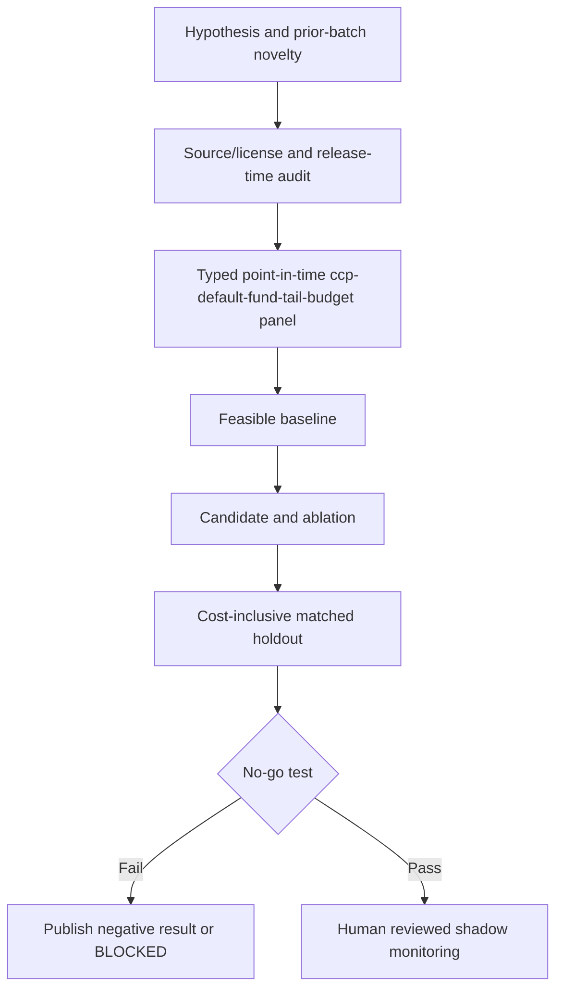

# WORKFLOW — CCP Default-Fund Mutualization Marginal Risk Budget

## Decision-specific gates
1. Scope: Set internal clearing exposure budgets based on potential default-fund replenishment and contingent mutualized-loss allocation.
2. Acquire only Public CPMI/IOSCO disclosure framework, synthetic member default distributions, concentration factors, CCP product eligibility and fee schedules. as legally allowed; Use published CCP rulebooks and dated quantitative disclosures only when released; past final stress reports cannot enter historical decisions early.
3. Check mathematical constraints: j clearing membership or CCP, s default scenario, alpha stress-tail quantile; actual waterfall order and limits are CCP specific.
4. Test `Exposure limit proportional to initial margin only` versus `Transparent worst-two-member default waterfall simulator` on same opportunity set and costs.
5. Challenge result with: Actual default fund contributions and replenishment terms may differ from public examples and vary by venue.
6. Pre-committed stop: No material differentiation in conditional tail loss versus margin-only limits after conservative parameter uncertainty.
7. Present tail capital charge, stress shortfall, liquidity buffer usage, net clearing benefit and capital/execution capacity (Default fund and extra margin liquidity headroom, clearing fees and enforceable contribution caps.).
8. Human review and explicit rollback. Negative outcomes remain research output.

**No workflow, connector or runtime was executed for this proposal.**
