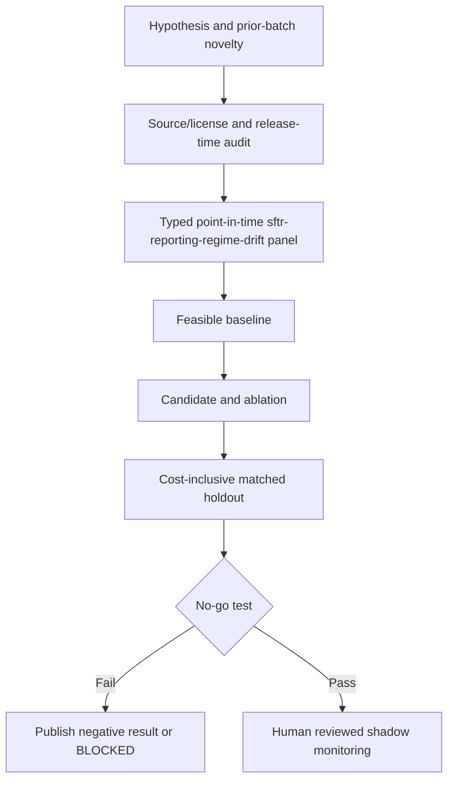

# WORKFLOW — SFTR Reporting Regime Drift and Public-Private Divergence Detector

## Decision-specific gates
1. Scope: Detect structural reporting-quality breaks before using reported SFTR aggregates as market exposure signals.
2. Acquire only ESMA reporting rules and publications, public aggregate exposures where available, historical methodology changes, synthetic backdated schema versions. as legally allowed; Use publication timestamps and repository versions, not reporting reference dates; detailed transaction data are supervisor-restricted.
3. Check mathematical constraints: q is alarm threshold chosen before holdout; changes attributed to reporting are hypotheses until repository audit.
4. Test `Fixed ±3-sigma z-score alert on each series` versus `Robust multivariate Bayesian online change-point detection` on same opportunity set and costs.
5. Challenge result with: Only public aggregate data may be available, making root-cause verification incomplete.
6. Pre-committed stop: Synthetic change fixtures not detected within agreed delay or false alerts exceed preregistered burden.
7. Present break detection delay, false alarms, post-correction economic interpretation stability and capital/execution capacity (Low runtime; review cost per alert and regulator/source availability dominate feasibility.).
8. Human review and explicit rollback. Negative outcomes remain research output.

**No workflow, connector or runtime was executed for this proposal.**
