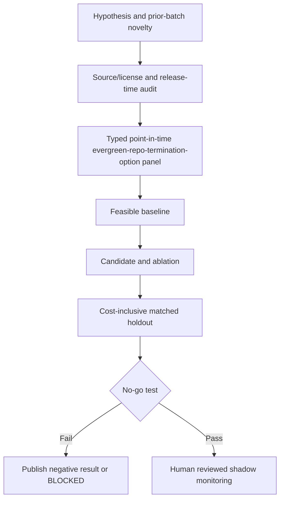

# WORKFLOW — Evergreen Repo Early-Termination Optionality Risk Budget

## Decision-specific gates
1. Scope: Set rate/tenor risk charges for unilateral termination and extension rights in open repo or evergreen funding.
2. Acquire only Synthetic open-repo terms, public SOFR and OFR repo curve history, legally enforceable reset/termination terms and funding costs. as legally allowed; Public repo rates have release lags; exact contract termination rights must be known at contract initiation, not retrofitted.
3. Check mathematical constraints: exercise and continuation are contract-party-specific; funder and borrower exercise incentives must be separately simulated.
4. Test `Static repo spread plus deterministic notice-day funding reserve` versus `Least-squares Monte Carlo for bilateral asymmetric stop decisions` on same opportunity set and costs.
5. Challenge result with: Non-observed counterparty exercise behavior; public term repo alone does not identify proprietary notice clauses.
6. Pre-committed stop: Option charge unstable or no improvement over conservative notice reserve in stress holdouts.
7. Present replacement funding loss, option premium calibration, cash-flow stress, tail liquidity gap and capital/execution capacity (Bilateral notice terms, term borrowing capacity, haircuts and closeout spreads constrain exercise decisions.).
8. Human review and explicit rollback. Negative outcomes remain research output.

**No workflow, connector or runtime was executed for this proposal.**
