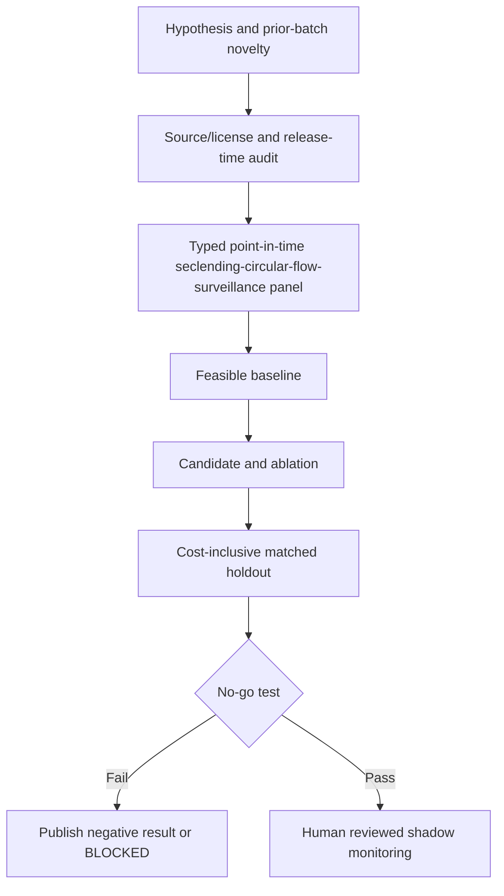

# WORKFLOW — Securities-Lending Circular Flow Surveillance via Temporal Graphs

## Decision-specific gates
1. Scope: Escalate suspicious short-lived circular borrow/return patterns for compliance review without inferring wrongdoing from volume alone.
2. Acquire only Synthetic multi-party loan/return event graph, matched collateral movement, legitimate transfer controls, anonymized case annotations if permitted. as legally allowed; Create graph only from recorded transfers visible before alert time; disallow knowledge of subsequent investigation outcomes in features.
3. Check mathematical constraints: K is review budget; temporal motif score must be conditioned on legitimate inventory transfers and settlement cycles.
4. Test `Two-party net-quantity turnaround rules` versus `Temporal graph motif detection with exact deterministic event identity` on same opportunity set and costs.
5. Challenge result with: False accusations, privileged customer data, and severe sample-selection bias in investigated cases.
6. Pre-committed stop: No precision@K gain against pairwise rules under benign high-volume churn fixtures.
7. Present precision at K, seeded motif recall, legitimate-flow false-alerts, explanation fidelity and capital/execution capacity (Compliance analyst review capacity and evidentiary retention, no automatic client suspension.).
8. Human review and explicit rollback. Negative outcomes remain research output.

**No workflow, connector or runtime was executed for this proposal.**
