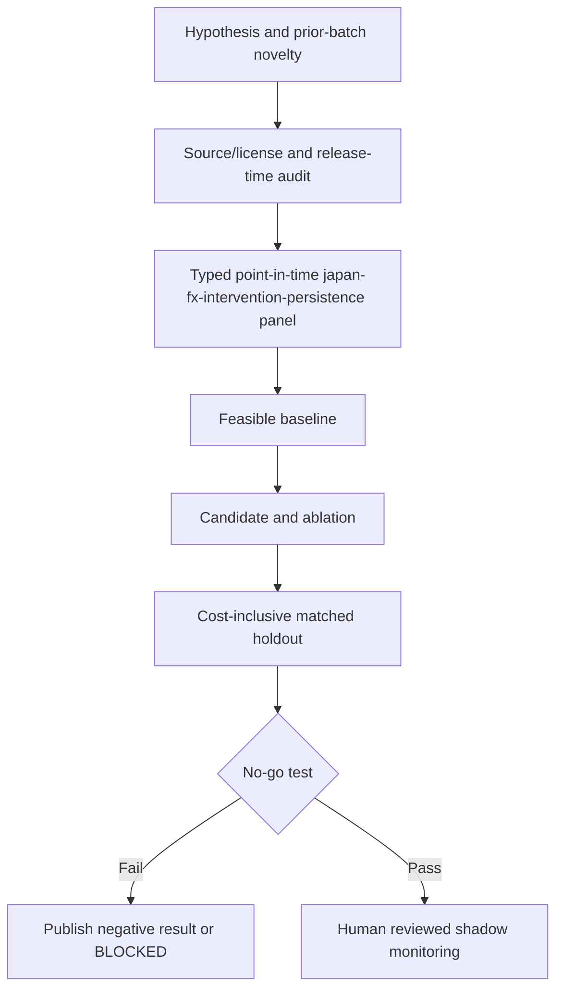

# WORKFLOW — Japan FX Intervention Impact and Option-Skew Persistence

## Decision-specific gates
1. Scope: Determine when to reduce/hedge yen exposure following **publicly observed** intervention or subsequent official disclosure.
2. Acquire only MOF monthly/quarterly intervention releases and dates, spot FX, short-term rate differential, timestamped USDJPY options/forward data. as legally allowed; MOF 2026 Q3 intervention details published Nov 9, 2026; never use ex-post intervention date labels in same-day live-time signals.
3. Check mathematical constraints: InterventionKnownAt_t is zero until event is publicly known or release issued; h is forward horizon, and skew is an executable options quote measure.
4. Test `Standard spot momentum and monetary-policy announcement dummy` versus `Disclosure-timestamp event study with matched controls and local projections` on same opportunity set and costs.
5. Challenge result with: Actual intervention execution is not transparently known in real time; small event count undermines causal certainty.
6. Pre-committed stop: No differential response versus rate/central-bank news controls on withheld intervention disclosures or net-option-cost results.
7. Present incremental forward skew/vol forecast skill, delta-hedged net P&L, placebo events, risk-adjusted drawdown and capital/execution capacity (Executable FX spot/options spreads, liquidity, event jump exposure, market access and derivatives capital.).
8. Human review and explicit rollback. Negative outcomes remain research output.

**No workflow, connector or runtime was executed for this proposal.**
