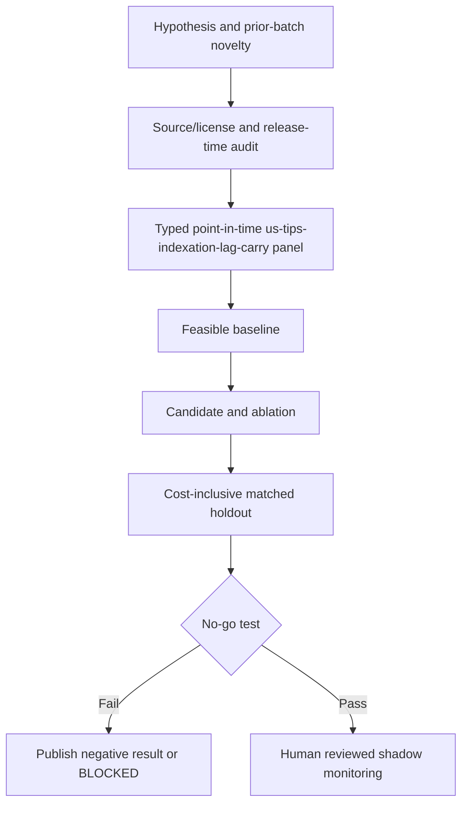

# WORKFLOW — US TIPS CPI Indexation-Lag Carry and Breakeven Calendar Surface

## Decision-specific gates
1. Scope: Select TIPS versus nominal duration-hedged exposure around CPI index-ratio carry windows.
2. Acquire only Treasury official daily TIPS index ratios/CPI, vintage BLS CPI, nominal/TIPS quotes, issue terms, accrued interest. as legally allowed; Daily index ratios can be forecast only from already published reference CPI; preserve first release and later corrections.
3. Check mathematical constraints: KnownIndexAccrual_t is observable at decision time; carry, breakeven and real-yield exposures require duration scaling and deflation floors.
4. Test `Duration-matched TIPS-minus-nominal bond without CPI-calendar signal` versus `Deterministic index-ratio accrual and liquidity-factor attribution` on same opportunity set and costs.
5. Challenge result with: Illiquid issue quotations, inflation floor optionality, unrevised CPI data and seasonality overfit.
6. Pre-committed stop: Improvement vanishes versus a carry-only and time-matched duration hedge after execution spread costs.
7. Present hedge tracking error, information ratio net of costs, index replication error, carry decomposition residual and capital/execution capacity (Issue-level depth, coupon accrued interest, repo funding, bid-ask, tax and duration hedging constraints.).
8. Human review and explicit rollback. Negative outcomes remain research output.

**No workflow, connector or runtime was executed for this proposal.**
