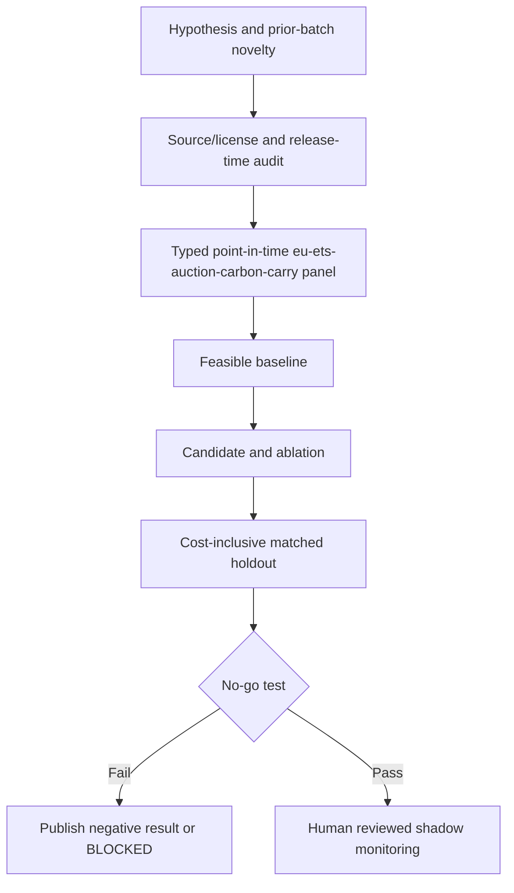

# WORKFLOW — EU ETS Auction Supply Revision and Carbon Futures Carry

## Decision-specific gates
1. Scope: Hedge EUA futures calendar spreads against only announced changes in auction volume and verified-emissions obligations.
2. Acquire only European Commission vintage auction calendars, Union Registry verified emissions/compliance, dated policy changes, EUA/power/gas contract prices. as legally allowed; 2027 auction schedule announced Jul 30 2026; 2025 compliance data public Oct 5 2026; only released data at as-of permitted.
3. Check mathematical constraints: m,n are contract maturities; expectations only use public revisions available before trade, not full-year realized auction volumes.
4. Test `Calendar-month fixed seasonal allowance spread` versus `Event study of auction schedule revisions and futures risk factors` on same opportunity set and costs.
5. Challenge result with: Policy revision expectations may be priced before official publication; futures/Registry coverage not contemporaneous.
6. Pre-committed stop: No out-of-sample spread forecast or hedge benefit net of spreads after matched energy factors.
7. Present EUA spread basis MAE, hedged risk reduction, net carry after fees, low-liquidity scenario loss and capital/execution capacity (EUA contract liquidity, expiry rolling, carbon compliance mandates and margin/collateral limits.).
8. Human review and explicit rollback. Negative outcomes remain research output.

**No workflow, connector or runtime was executed for this proposal.**
