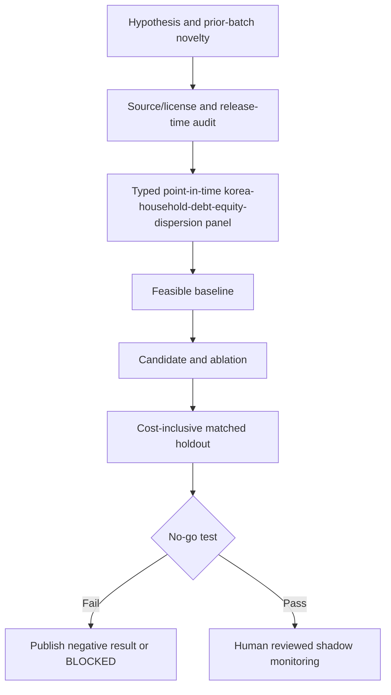

# WORKFLOW — Korean Household Debt-Service Shock to Bank–Consumer Equity Spread

## Decision-specific gates
1. Scope: Hedge relative exposure of Korean bank and consumer equities across household debt-service regime changes.
2. Acquire only BIS Korea household DSR, BOK/Statistics Korea public lending/rates, issuer earnings and local equity returns, reporting vintage. as legally allowed; BIS Korean DSR published with quarterly lag (available through 2026-Q1 on checked dataset page); do not trade on 2026-Q2 unless publicly released.
3. Check mathematical constraints: b bank peer basket, c consumer peer basket, h disclosure-to-outcome window; DSRSurprise uses real-time expected vs published DSR, not revised future panels.
4. Test `Equal-beta long banks short consumer discretionary with lagged policy-rate signal` versus `Panel local projections with shrinkage and sector time fixed effects` on same opportunity set and costs.
5. Challenge result with: Endogenous rate policy and sector composition cause confounding; public issuer histories need delisting continuity.
6. Pre-committed stop: No stable expected-earnings or beta-neutral sector difference once rates and economy factors are controlled.
7. Present cross-sector earnings forecast delta, beta-neutral IR, worst-regime drawdown, capacity after local spreads and capital/execution capacity (Local borrow, FX hedge, Korean market access, corporate action history, sector liquidity and taxes.).
8. Human review and explicit rollback. Negative outcomes remain research output.

**No workflow, connector or runtime was executed for this proposal.**
