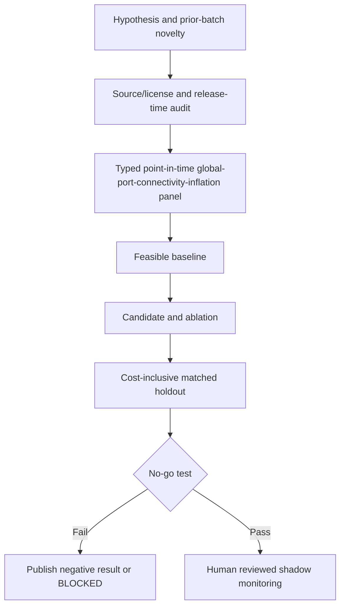

# WORKFLOW — Global Shipping Connectivity Re-Routing to Inflation and Equity Margins

## Decision-specific gates
1. Scope: Size logistics/inflation hedges when public route connectivity and port-service centrality shift.
2. Acquire only UNCTAD monthly/quarterly liner connectivity, MARAD freight/port dashboards, shipping rate indexes where licensed, CPI/PPI and issuer logistics costs. as legally allowed; UNCTAD latest confirmed index data update Sep 28 2026; a 2026-11-20 decision cannot use December data.
3. Check mathematical constraints: r is importer region, p port corridor; shocks and alternate route count must use actually published index vintage.
4. Test `Aggregate global shipping index versus region CPI with fixed lag` versus `Supply-route network exposure local projections` on same opportunity set and costs.
5. Challenge result with: Connectivity is not real-time port congestion and quarterly updates can obscure freight cycle timing.
6. Pre-committed stop: No incremental signal after global industrial production, oil and published trade volume controls.
7. Present inflation nowcast gain, equity margin dispersion, attribution stability and hedged net P&L and capital/execution capacity (Sector ETF/futures depth, global market close mismatch, FX hedge and rebalance slippage.).
8. Human review and explicit rollback. Negative outcomes remain research output.

**No workflow, connector or runtime was executed for this proposal.**
