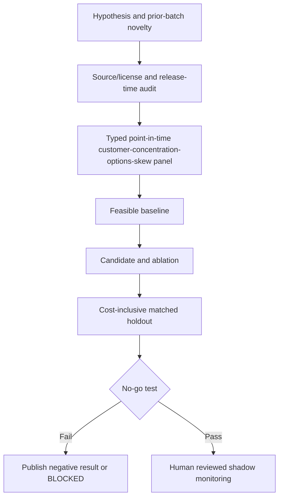

# WORKFLOW — Issuer Customer-Concentration Disclosure to Earnings Options Skew

## Decision-specific gates
1. Scope: Hedge customer-loss jump risk in companies with concentrated customers using explicitly costed options structures.
2. Acquire only SEC EDGAR original issuer filings, customer concentration disclosures, single-stock option surface, earnings calendar, liquidity and corporate actions. as legally allowed; Use SEC acceptance timestamps and first published disclosure, not retroactive tagged XBRL after amended filings.
3. Check mathematical constraints: HHI is sum of squared disclosed customer revenue shares (bounded/partially observed); t-known is filing dissemination time, not fiscal year end.
4. Test `Size/leverage/industry/earnings event-only option skew estimator` versus `Censored-disclosure panel with inverse observation probability adjustment` on same opportunity set and costs.
5. Challenge result with: Customer concentrations may be anonymized and nonrandomly omitted; options trade data can be illiquid.
6. Pre-committed stop: No post-filing incremental skew or hedge gain beyond conventional earnings-related jump risk.
7. Present post-filing skew residual, risk hedge efficiency, delta-neutral net performance and disclosure coverage and capital/execution capacity (Option open interest, bid/ask, assignment/maturity mechanics and volatile event hedging friction.).
8. Human review and explicit rollback. Negative outcomes remain research output.

**No workflow, connector or runtime was executed for this proposal.**
