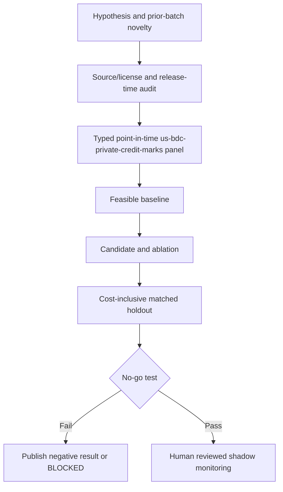

# WORKFLOW — Public BDC Portfolio Fair-Value Markdown Lead Indicator

## Decision-specific gates
1. Scope: Prioritize due diligence or credit hedges where public business development company holdings imply delayed loan fair-value marks.
2. Acquire only Original SEC BDC 10-Q/10-K investment schedules and mark values, sector classification, publicly known credit outcomes and licensed leveraged-loan pricing. as legally allowed; Use filed investment schedules only after filing acceptance; amendments/revised portfolio marks cannot enter historical quarters.
3. Check mathematical constraints: PriceToCost is reported fair value over cost, nonaccrual flags only as filed, FundLag is filing delay; target is future externally validated credit deterioration.
4. Test `BDC aggregate NAV discount and published nonaccrual percentage` versus `Issuer-level mark-hazard panel with censored holdings and missing-not-at-random controls` on same opportunity set and costs.
5. Challenge result with: BDC portfolio company identities, valuation methods and distressed sales are not uniformly disclosed; matching bias.
6. Pre-committed stop: No improvement over current NAV discount/nonaccrual baseline in later quarters or effects only known after financial reports.
7. Present future credit-event AUC/PR, mark-calibration error, NAV stress accuracy, opportunity capacity and capital/execution capacity (BDC equity market depth, credit hedging basis, optional loan trading access and stale valuation discounts.).
8. Human review and explicit rollback. Negative outcomes remain research output.

**No workflow, connector or runtime was executed for this proposal.**
